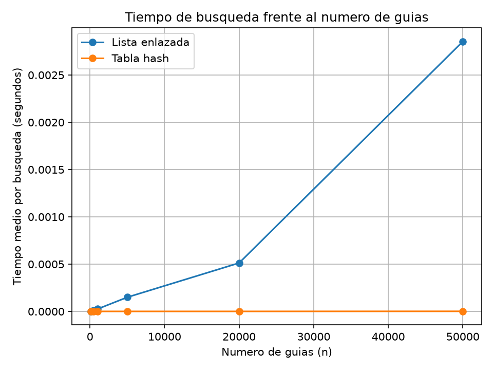
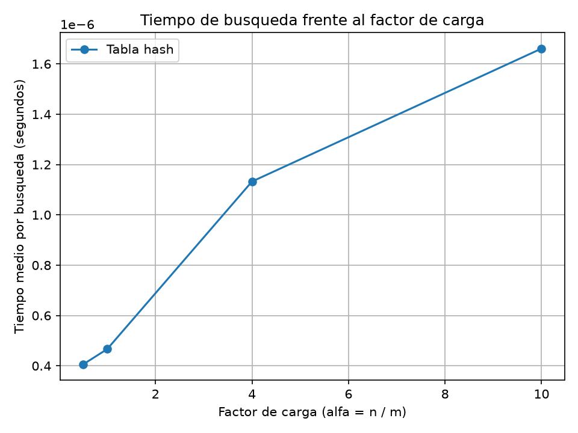

# Laboratorio evaluativo 03 — Estructuras de datos

## Estudiante

Erian Jose Serna Marin

## Instrucciones para reproducir el experimento

### Creación del entorno virtual

Para crear el entorno virtual se utiliza:

```bash
python3 -m venv venv
```

#

Para activarlo en Windows:

```bash
venv\Scripts\activate
```

Para activarlo en Linux:

```bash
source venv/bin/activate
```

#

Con este comando instalamos las librerías necesarias:

```bash
pip install -r requirements.txt
```

#

Nos ubicamos en la carpeta donde está el ejercicio:

```bash
cd lab3-estructuras-datos
```

#

### Ejecución de los experimentos

Para ejecutar las pruebas de la parte 1:

```bash
python pruebas.py
```

Para ejecutar los experimentos y generar las gráficas de la parte 2:

```bash
python medicion.py
```

#

## Parte 1 — Breve descripción de cómo verificó las estructuras y qué casos cubrió.

Código de las estructuras: [`estructuras.py`](estructuras.py)

Código de las pruebas: [`pruebas.py`](pruebas.py)

Para verificar las dos estructuras se utilizaron pruebas con guías existentes e inexistentes. Primero se comprobó que la lista enlazada permitiera insertar guías al inicio y encontrar correctamente sus estados. También se verificó que, cuando una guía no existe, la búsqueda devuelva `None`.

Después se probaron las mismas operaciones con la tabla hash, comprobando que cada guía se guardara en la casilla correspondiente y que la búsqueda devolviera el estado correcto.

Se hizo una prueba especial de colisiones utilizando una tabla con siete casillas. Las guías 10, 24 y 17 terminan en la casilla 3, porque al dividir cada una entre 7 el residuo es 3. Se comprobó que las tres pudieran almacenarse en la misma lista enlazada y recuperarse después sin confundir sus estados. También se verificó que el factor de carga fuera igual a `3 / 7`.

Finalmente, se probaron veinte colecciones generadas aleatoriamente. Para cada colección se compararon los resultados de las dos estructuras, tanto para las guías existentes como para las inexistentes. Las pruebas se realizaron utilizando `assert`, por lo que, si alguna condición no se cumple, Python indica que existe un problema.

#

## Parte 2 — Las gráficas y una nota sobre cómo se midió.

Código de [`medicion.py`](medicion.py)

Para realizar las mediciones se utilizó `time.perf_counter()`, midiendo únicamente el tiempo empleado en las búsquedas, sin incluir la construcción de las estructuras ni la generación de los datos.

En el primer experimento se utilizaron los tamaños `100, 500, 1000, 5000, 20000 y 50000`. Para cada tamaño se generaron guías distintas de diez dígitos y se utilizó la misma colección para la lista enlazada y la tabla hash. La tabla se construyó con un número primo de casillas cercano a la mitad de la cantidad de guías, de manera que el factor de carga quedara alrededor de 2.

Para cada configuración se realizaron 200 búsquedas de guías inexistentes y se calculó el tiempo promedio por búsqueda. Estas guías se generaron con una semilla fija para facilitar la reproducción de los resultados.

En el segundo experimento se mantuvieron 20.000 guías y se probaron cuatro factores de carga: `0.5, 1, 4 y 10`. Para conseguirlos se utilizaron, respectivamente, `40000, 20000, 5000 y 2000` casillas.

Las mediciones se realizaron en una ejecución por configuración, utilizando el promedio de las 200 búsquedas. Por eso, los tiempos pueden variar ligeramente al ejecutar nuevamente el programa.

### Gráfica 1 — Lista enlazada frente a tabla hash



En esta gráfica se compara el tiempo medio de búsqueda de las dos estructuras cuando aumenta la cantidad de guías.

### Gráfica 2 — Efecto del factor de carga



En esta gráfica se observa cómo cambia el tiempo medio de búsqueda de la tabla hash cuando aumenta el factor de carga.

#

## Parte 3 — Análisis.

## 1. Costo teórico.

Justifique por qué buscar en la lista enlazada cuesta Θ(n) para una guía inexistente, y por qué buscar en la tabla con encadenamiento cuesta en promedio Θ(1 + α). Diga qué supuesto sobre la función hash sostiene ese resultado y qué le pasaría a la tabla si todas las guías cayeran en la misma casilla.

### R//

Cuando se busca una guía que no existe en una lista enlazada, es necesario recorrer todos sus nodos para comprobar que no está. Por eso, si hay n guías, el costo de la búsqueda es Θ(n).

En la tabla hash primero se calcula la casilla correspondiente a la guía y después se revisa la lista enlazada de esa casilla. En promedio, el costo es Θ(1 + α), donde α es el factor de carga, calculado dividiendo la cantidad de guías entre el número de casillas.

Este comportamiento supone que la función hash distribuye las guías de manera suficientemente uniforme entre las casillas. Si todas terminaran en la misma, la tabla perdería su ventaja y las búsquedas podrían costar Θ(n), porque habría que recorrer una lista que contendría todas las guías.

#

## 2. Lo medido contra lo esperado.

A partir de su primera gráfica, tome dos valores consecutivos de n y calcule cuánto se multiplicó el tiempo de cada estructura; diga si coincide con Θ(n) y con Θ(1). Con su segunda gráfica, describa cómo cambia el tiempo cuando α crece y si es coherente con Θ(1 + α).

### R//

En el primer experimento, al pasar de 20.000 a 50.000 guías, el tiempo de la lista enlazada pasó de `0.00082291 s` a `0.00163185 s`, aproximadamente el doble. La cantidad de guías aumentó 2,5 veces, así que el resultado no es exactamente proporcional, pero sí muestra la tendencia de crecimiento lineal esperada para una búsqueda infructuosa.

En la tabla hash, el tiempo pasó de `0.00000221 s` a `0.00000071 s`. Aunque disminuyó, esto no significa que la tabla se vuelva más rápida al aumentar las guías. Son tiempos muy pequeños y las variaciones del cronómetro pueden influir bastante en los resultados. Como el factor de carga se mantuvo alrededor de 2, se esperaba que el tiempo promedio cambiara poco.

En el segundo experimento, el tiempo aumentó de `0.00000041 s` con un factor de carga de 0,5 a `0.00000166 s` con un factor de carga de 10. Esto representa aproximadamente cuatro veces el tiempo inicial. El resultado es coherente con la idea de que, cuando hay más guías por casilla, aumenta el trabajo necesario para buscar una guía inexistente.

#

## 3. Explique las colisiones.

Explique qué es una colisión y por qué ocurre aunque la tabla tenga más casillas que guías. Describa cómo la resuelven el encadenamiento y el direccionamiento abierto, y diga qué ventaja y qué costo tiene cada uno. Use la colisión de las guías 10, 24 y 17 con m = 7 como ejemplo.

### R//

Una colisión ocurre cuando dos o más guías producen el mismo índice al aplicar la función hash. Esto puede pasar incluso cuando hay más casillas que guías, porque diferentes números pueden tener el mismo residuo al dividirlos entre el número de casillas.

Por ejemplo, con `m = 7`, las guías 10, 24 y 17 terminan en la casilla 3. En el encadenamiento utilizado en este laboratorio, las tres se guardan en una lista enlazada dentro de esa casilla. Su ventaja es que permite almacenar varias guías en la misma posición sin tener que buscar otra casilla libre, aunque las búsquedas pueden volverse más lentas si la lista crece mucho.

El direccionamiento abierto, en cambio, busca otra posición disponible dentro de la propia tabla cuando ocurre una colisión. Esto evita mantener listas enlazadas en cada casilla, pero puede requerir varias comprobaciones para encontrar una posición libre o localizar una guía, especialmente cuando la tabla está muy ocupada.

#

## 4. Tabla hash o árbol de búsqueda.

Para el monitoreo por rango ("guías entre X y Y"), ¿sirve la tabla hash? Justifique. Explique qué ofrece un árbol de búsqueda binario para esa consulta, y qué pasaría si las 400.000 guías llegaran ya ordenadas y se insertaran una a una: estime la altura resultante y el número aproximado de comparaciones, y compare con el caso de un árbol equilibrado.

### R//

La tabla hash es adecuada para consultar el estado de una guía específica, pero no es la mejor opción para buscar todas las guías que se encuentran entre dos números. Esto se debe a que las guías se distribuyen según el resultado de la función hash y no quedan ordenadas numéricamente.

Un árbol de búsqueda binario permite mantener las guías organizadas de acuerdo con su valor y recorrerlas en orden. De esta manera, se pueden localizar las guías que están dentro de un rango sin tener que revisar necesariamente toda la colección.

Sin embargo, si las 400.000 guías llegan ordenadas y se insertan una por una en un árbol binario sin equilibrar, el árbol puede quedar prácticamente como una lista. Su altura sería cercana a 400.000 niveles y una búsqueda podría necesitar hasta 400.000 comparaciones. Para una guía ubicada en una posición intermedia, el número de comparaciones podría rondar las 200.000.

En un árbol equilibrado, la altura sería mucho menor, cercana a `log₂(400000)`, es decir, unos 19 niveles. Por eso, para mantener buenas búsquedas y consultas por rango, conviene utilizar un árbol que se mantenga equilibrado.

#

## 5. Concepto para la jefa de operaciones.

Recomiende una estructura (o una combinación) para cubrir las dos necesidades. Estime, a partir de su medición, cuánto tardaría una búsqueda de una guía inexistente en cada estructura con 5.000.000 de envíos. Declare que es una estimación y explique el razonamiento (no use una regla de tres sin justificar la forma de la curva).

### R//

Para Rutas del Caribe recomiendo utilizar una combinación de estructuras. Para las consultas puntuales del call center utilizaría una tabla hash, porque permite encontrar el estado de una guía en un tiempo promedio bajo cuando la función hash distribuye bien los datos y el factor de carga se mantiene controlado. Para las consultas por rango del supervisor utilizaría un árbol de búsqueda binario equilibrado, porque mantiene las guías ordenadas y facilita recuperar las que se encuentran entre dos valores.

Para estimar los tiempos con cinco millones de envíos, tomo como referencia la medición con 50.000 guías. La lista enlazada tardó `0.00163185 s` por búsqueda infructuosa. Como su crecimiento es lineal, multiplicar la cantidad de guías por 100 permite estimar un tiempo de aproximadamente:

`0.00163185 × 100 = 0.163185 s`

Por tanto, una búsqueda infructuosa en la lista podría tardar alrededor de 0,16 segundos, bajo el supuesto de que se mantiene el comportamiento lineal observado.

En la tabla hash, la medición con 50.000 guías fue de `0.00000071 s`, con un factor de carga cercano a 2. Si se mantienen un factor de carga similar y una distribución uniforme, el costo promedio esperado depende principalmente de ese factor y no del número total de guías. Como referencia, el tiempo podría mantenerse en el orden de las fracciones de microsegundo, aproximadamente 0,00000071 segundos por búsqueda.

Estos valores son estimaciones y no tiempos garantizados. La medición de la tabla hash es especialmente sensible a las variaciones del cronómetro porque las búsquedas duran muy poco. Además, el resultado real dependerá de la distribución de las guías, del número de casillas y del equipo utilizado. Aun así, los experimentos muestran por qué una tabla hash es una mejor alternativa para las consultas puntuales, mientras que un árbol equilibrado es más adecuado para los rangos.

#